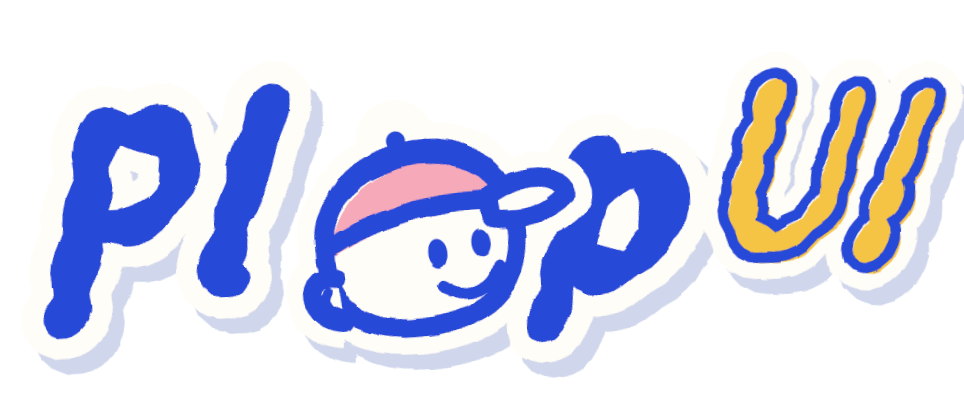

<p align="center"></p>

<p align="center"><strong>A hand-lettered sticker UI kit for real-time operations apps.</strong><br>Press it like you mean it.</p>

<p align="center">
  <a href="https://www.npmjs.com/package/@plop-ui/react"></a>
  <a href="https://github.com/Snorlark/plop-ui/actions/workflows/ci.yml"></a>
  <a href="LICENSE"></a>
  <a href="https://plop-ui.vercel.app"></a>
</p>

<p align="center">
  <a href="https://plop-ui.vercel.app"><b>Docs</b></a> ·
  <a href="https://plop-ui.vercel.app/docs/getting-started">Getting started</a> ·
  <a href="https://plop-ui.vercel.app/playground">Playground</a> ·
  <a href="https://plop-ui.vercel.app/kit">Every component</a> ·
  <a href="https://plop-ui.vercel.app/changelog">Changelog</a>
</p>

Plop! is an open-source React + TypeScript component library for dispatch, field service and ticketing apps. Everything is drawn in one cobalt marker on cream paper: die-cut sticker buttons, hatched shadows, boiling ink outlines, a cast of little characters, and press feedback you can feel (a squish, an ink burst, a buzz on your phone). Every "imperfection" is seeded, so it renders the same on the server and the client.

The "o" in the logo is the capped buddy who peeks over the top of a `Button`. He is the kit's mascot, and his friends show up wherever the kit has something to tell you.

## Packages

| Package | What it is |
| --- | --- |
| [`@plop-ui/react`](packages/react) | Components, hooks, the buddy cast, `onColor`, seeded randomness |
| [`@plop-ui/tokens`](packages/tokens) | Colors, contrast roles, type, motion and 5 surfaces, as CSS variables and a typed object |
| [`@plop-ui/fonts`](packages/fonts) | Sketchpop, the hand-drawn marker family (SIL OFL 1.1) |

## Quick start

```sh
npm i @plop-ui/react @plop-ui/fonts      # or: pnpm add @plop-ui/react @plop-ui/fonts
```

```tsx
import "@plop-ui/fonts/fonts.css";
import "@plop-ui/react/styles.css";
import { PlopProvider, Button, StatusTimeline, toast } from "@plop-ui/react";

export function App() {
  return (
    <PlopProvider surface="poster">
      <Button variant="ink" buddy onClick={() => toast.success("Report sent", { buddy: true })}>
        Send report
      </Button>
      <StatusTimeline steps={["Reported", "Dispatched", "En route", "Resolved"]} current={2} />
    </PlopProvider>
  );
}
```

For the paper to cover the whole screen (not just your content), and why buttons stretch inside a grid, see [Good to know](https://plop-ui.vercel.app/docs/getting-started) in the Getting Started guide.

Using Next.js? The library never imports `next/*`, and every interactive component already carries `"use client"`, so it drops straight into the App Router. Static pieces like `StatusTimeline` stay Server Components. See [Using with Next.js](https://plop-ui.vercel.app/docs/nextjs).

## What's in the kit

| Group | Pieces |
| --- | --- |
| **Actions** | `Button`, `ButtonLink`, `IconButton`, `Tooltip` |
| **Inputs** | `TextField`, `TextArea`, `Switch`, `Checkbox`, `RadioGroup` / `Radio`, `SearchField` |
| **Navigation** | `CommandPalette` (⌘K / Ctrl K), `Tabs` |
| **Display** | `Tag`, `Avatar`, `AvatarStack`, `TicketCard`, `UnitCard`, `StickyNote`, `Count`, `StatusDot`, `EmptyState` |
| **Feedback** | `StatusTimeline`, `Progress`, `Callout`, `Toast` / `toast()` |
| **Characters** | `Buddy`, `BuddyPeek`: six characters, one per state |
| **Lettering** | `Heading`, `Lettering`, `WordSticker`, `Doodle` |
| **Foundations** | `PlopProvider`, `Sheet`, `PlopFilters`, 21 hand-drawn icons |
| **Hooks** | `useHaptics`, `useSound`, `useBoil`, `useInkBurst`, `useReducedMotion` |
| **Utilities** | `onColor` / `contrastRatio` (readable text on any fill), `seed` / `seededTilt` / `seededPick` |

### The cast

Each character stands for exactly one state, everywhere in the kit:

| Character | Mood | Shows up for |
| --- | --- | --- |
| Pip | `success` | Things that went right |
| Bix | `error` | Things that went wrong |
| Snooze | `stale` | Data that hasn't updated in a while |
| Confetti | `congrats` | Milestones worth celebrating |
| Specs | `preview` | Previews and drafts |
| Hum | `thinking` | Loading and working |

Pass `buddy` to `Toast`, `toast()` or `Callout` and the right character appears for the kind or tone, or pass a mood to choose one. A character never carries the message alone: the text always says it too.

### Feedback that matches the intent

Pressing a sticker gives you an ink burst and a short haptic tap on phones that support it. Soft "plop" sounds are off by default; turn them on only after someone asks for them. Destructive (`tomato`) buttons shake their head and puff a little dust instead of throwing confetti. One `PlopProvider` at the root sets `haptics` and `sound` for everything inside it.

### Surfaces

Five paper surfaces, each in light and dark: **Poster**, **Cutting mat**, **Notebook**, **Kraft** and **Riso**. Set one with `<PlopProvider surface="kraft">`. Every color pairing meets WCAG 2.2 AA on every surface.

### Accessible by default

Native elements first, full keyboard support, visible focus, AA contrast on every surface in light and dark, and every effect respects `prefers-reduced-motion`.

## The docs site

It's live at **[plop-ui.vercel.app](https://plop-ui.vercel.app)** (or run it locally, see below):

| Page | What it is |
| --- | --- |
| `/` | The landing page: why Plop, how a sticker is made, and every component |
| `/docs/getting-started` | Installation, the Next.js guide, surfaces, tokens, accessibility, hooks, and one page per component |
| `/playground` | Three tools: a **Sticker board** to arrange real components and copy the code, a **Lettering** studio to make hand-lettered words and export them as React, HTML, SVG or PNG, and **Tweak a component** to change any prop live |
| `/kit` | Every piece on one page |

Press ⌘K / Ctrl K (or `/`) on any page to search every component and docs page.

New here? The ticket stub in the bottom-right corner of every page opens the **Ride-along pass**: a five-stop tour (what Plop is, install, components, playground, GitHub) that stamps each stop as you reach it. Finish it and Holo Pip is yours.

## Run it locally

You need Node 20+ and pnpm 11 (`corepack enable` sets pnpm up for you).

```sh
pnpm install
pnpm build                              # builds tokens, fonts, the library and the apps
pnpm --filter @plop-ui/docs dev         # docs site  → http://localhost:4321
pnpm --filter @plop-ui/dispatch-demo dev  # dispatch demo → http://localhost:4322
pnpm --filter @plop-ui/storybook dev    # Storybook  → http://localhost:6006
```

The apps use the library's **built** output (`packages/react/dist`), not its source. If you change the library while the docs site is running, also run `pnpm --filter @plop-ui/react dev` in a second terminal so it rebuilds on save. If you don't, the site keeps the old build, and something you just exported will show up as "not a function".

## Checks

```sh
pnpm lint
pnpm typecheck
pnpm test                               # Vitest + Testing Library (packages/react)
pnpm size                               # size-limit budgets for the library
pnpm --filter @plop-ui/docs test:e2e    # Playwright: hydration, axe on every page and surface, keyboard
                                        # (builds into .next-e2e, so it's safe while the dev server runs)
```

## Repo map

```
PRD.md            what we're building and why (with a status table)
TASKS.md          what to do next
CLAUDE.md         the rules the codebase follows
CONTRIBUTING.md   how to contribute, step by step
packages/tokens   design tokens → CSS variables + typed object (source: src/tokens.ts)
packages/fonts    Sketchpop woff2/ttf, the OFL license, font build tools
packages/react    @plop-ui/react (esbuild, CSS Modules, per-file "use client")
apps/docs         Next.js 15 site: landing, docs, playground, /kit
apps/dispatch-demo  Next.js 15 live incident queue built only from Plop! (SSE + Server Action)
apps/storybook    Storybook 8 workshop with the a11y addon
docs/decisions    one short file per decision: what we chose and why
docs/prototype    the original v0.6 HTML prototype
docs/assets       the logo and the buddy mark
```

## Contributing

Contributions are welcome: bug fixes, new components, docs, or a new character. Read **[CONTRIBUTING.md](CONTRIBUTING.md)**, which covers setup, the codebase rules, how to add a component from start to finish, and how to open a pull request. Not sure where to start? Pick something from [TASKS.md](TASKS.md).

## License

Code: [MIT](LICENSE), © 2026 Lark Sigmuond Babao. The Sketchpop font: [SIL Open Font License 1.1](packages/fonts/OFL.txt), so you can use, bundle and modify it freely, including in commercial work.
