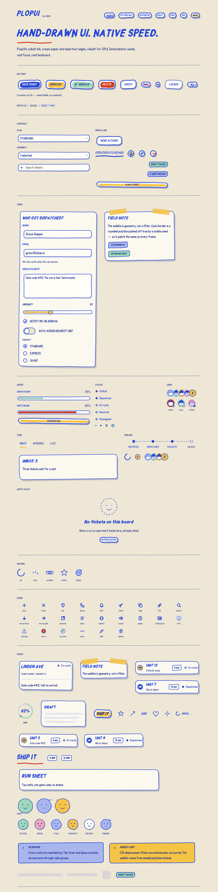
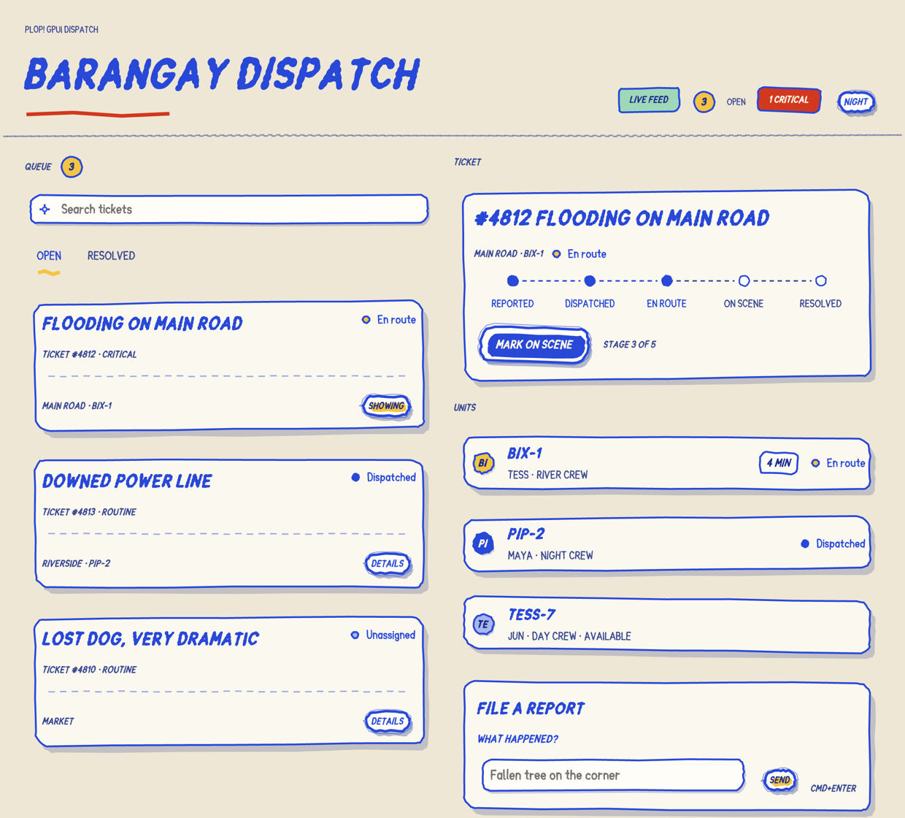
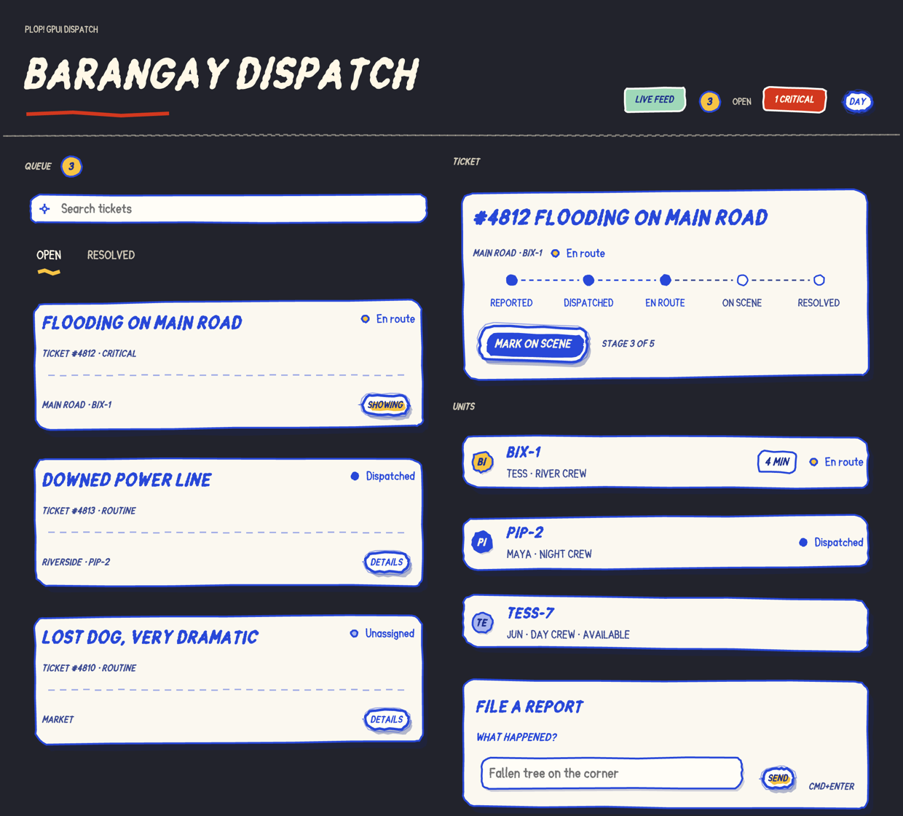

# plopui-gpui

PlopUI's hand-drawn tokens and geometry, rebuilt for [GPUI](https://gpui.rs). Same cobalt ink, cream paper and seeded wobble, painted by a native renderer instead of a browser.



Experimental, but runnable and tested: 52 components, a live toast queue, deterministic paint, real focus, real keyboard, a spinner that respects reduced motion, seeded ink bursts on press, and a full dispatch console example. It is not published to crates.io.

## Run the gallery

```sh
cargo run -p plopui-gpui --example gallery
```

The window is 1240×920. The surface switcher in the top right changes the paper; the **NIGHT** tag toggles light and dark. You can also start on a given surface:

```sh
PLOP_SURFACE=notebook PLOP_DARK=1 cargo run -p plopui-gpui --example gallery
```

`PLOP_SURFACE` accepts `poster` (default), `mat`, `notebook`, `kraft` and `riso`.

## Capture a PNG

```sh
PLOP_CAPTURE_HEIGHT=5050 cargo run -p plopui-gpui --example capture
```

This renders the gallery off-screen with the headless renderer and writes `/tmp/plopui-gallery.png` (2480×10100 at 2× for the full sheet). It does not need a visible window or an unlocked desktop session; a locked macOS login window is fine.

| Variable | Default | What it does |
| --- | --- | --- |
| `PLOP_CAPTURE_OUT` | `/tmp/plopui-gallery.png` | Output path |
| `PLOP_CAPTURE_HEIGHT` | `920` | Window height in logical pixels; raise it to capture the whole page |
| `PLOP_SURFACE` / `PLOP_DARK` | `poster` / off | Same as the gallery |

The images in `docs/assets/gpui-gallery.png` and `gpui-gallery-dark.png` were produced with `PLOP_CAPTURE_HEIGHT=5050` and, for the dark one, `PLOP_SURFACE=notebook PLOP_DARK=1`, then scaled to 1240 px wide. Every exported component appears somewhere on the sheet: the status dots, tab panels, unit-card row, lettering, ETA tags and the full run sheet were the last ones added.

## The dispatch app

`examples/dispatch.rs` is the React `apps/dispatch-demo` rebuilt as a native app: a ticket queue with search, the five-stage timeline, unit cards, a report form and the live toast queue. The gallery proves each component in isolation; this one proves they compose. Both examples install the ink burst host, so every sticker throws a splat when you click it.



```sh
cargo run -p plopui-gpui --example dispatch
PLOP_CAPTURE_OUT=/tmp/dispatch.png cargo run -p plopui-gpui --example dispatch
PLOP_DARK=1 PLOP_SURFACE=notebook PLOP_CAPTURE_OUT=/tmp/dispatch-dark.png \
  cargo run -p plopui-gpui --example dispatch
PLOP_DISPATCH_QUERY=zzz PLOP_CAPTURE_OUT=/tmp/dispatch-empty.png \
  cargo run -p plopui-gpui --example dispatch
```

The window is 1240×1120 with a 1024×860 minimum. Type in **Search tickets** to filter the queue by kind, place or assigned unit; the empty state says whether the queue is quiet or the search found nothing, and its one button either clears the search or switches tabs. `PLOP_DISPATCH_QUERY` opens the app already filtered. **/** jumps to the search from anywhere outside a text field, and **Escape** empties it. Pick a ticket with **DETAILS**, then advance it with the stage button; the last step holds the loading button for 900 ms before the toast arrives. **SEND** files a new report and selects it, and **⌘Enter** / **Ctrl+Enter** does the same from anywhere in the window. **NIGHT** flips the paper.



Tabs, ticket buttons, fields and the stage action are all reachable from the keyboard.

## Components

### Actions

| Component | Notes |
| --- | --- |
| `PlopButton` | Die-cut sticker; `fill`, `disabled`, `small`, `icon_only`, `flat`, `icon`, `loading`/`loading_label`, `on_click` |
| `PlopButtonLink` | Link semantics: Enter activates, Space does not; hand-drawn underline |
| `PlopIconButton` | Square sticker for a glyph or one of the 24 `IconKind`s, with a separate accessible label |
| `PlopMenu` | Trigger plus focusable items; Enter runs an item and closes the menu |
| `PlopTooltip` / `plop_tooltip` | Native GPUI tooltip containing a paper card |
| `PlopCommandPalette` | Absolute overlay with query input; Up/Down/Enter/Escape captured |

### Inputs

| Component | Notes |
| --- | --- |
| `PlopCheckbox` | `gpui-base` checkbox behind the hand-drawn box; Space toggles |
| `PlopSwitch` | `gpui-base` switch behind the hand-drawn track; Space flips |
| `PlopRadio` | `gpui-base` radio behind the hand-drawn ring |
| `PlopRadioGroup` | Legend, one roving tab stop; arrows and Home/End move the selection and focus, Space activates |
| `PlopTextField` | `gpui-base` input: IME, selection, clipboard and undo stay native |
| `PlopTextArea` | Multi-line `gpui-base` state on a hand-drawn sheet |
| `PlopSlider` | `gpui-base` slider state; arrows, Home/End and pointer drag share one value |
| `PlopSelect` | Combobox: Space/Enter/Down opens, arrows move, Escape closes |
| `PlopMultiSelect` | Open panel with one focus handle per option; Space toggles |
| `PlopSearchField` | `gpui-base` input with a magnifier on a painted field |

### Navigation

| Component | Notes |
| --- | --- |
| `PlopTabs` | Roving focus: arrows move and select, Home/End jump, Enter/Space reselect |
| `PlopBreadcrumb` | Ink trail with the current page in full strength |
| `PlopTabPanel` | Shows its children when the matching tab is selected |

### Display

| Component | Notes |
| --- | --- |
| `PlopTag` | Display-only torn-paper tag |
| `PlopCard` | Cream sheet, optional tape and title; establishes the paper text scope |
| `PlopSheet` | Large paper sheet for a page-level block |
| `PlopStickyNote` | Taped note with title, body or children |
| `PlopTicketCard` | Ticket stub with code, status and a perforation line |
| `PlopUnitCard` | Dispatch unit row: avatar, name, detail, ETA and status |
| `PlopUnitCardRow` | Vertical stack of unit cards |
| `PlopStatusDot` | Small status dot with size and label |
| `PlopStatus` | One of the five token statuses |
| `PlopAvatar` | A doodle face generated from the name, optional online/busy/offline dot; `.initials()` for team marks |
| `PlopAvatarStack` | Overlapping faces plus a `PlopCount` overflow chip |
| `PlopCount` | Round unread counter with an ink outline |
| `PlopEmptyState` | Dashed doodle, one sentence and one action |
| `PlopProgress` | Hand-drawn track and fill, optional label and value |
| `PlopProgressRing` | Seeded ring with percentage and optional caption |
| `PlopSkeleton` | Seeded placeholder bars |
| `PlopSkeletonText` | Multi-line skeleton with seeded line widths |
| `PlopLoader` | Spinner plus a waiting sentence |
| `PlopEta` | Small time estimate on a tag |
| `PlopDivider` | Wobbly rule |

### Feedback

| Component | Notes |
| --- | --- |
| `PlopCallout` | Info / warn / error / success |
| `PlopToast` | Compact message card |
| `PlopToaster` | Display-only stack of toasts, newest last |
| `ToastQueue` / `show_toast` / `PlopToastHost` | One live toast at a time: entity queue with auto-dismiss, app-wide helpers, and an observing host view |
| `PlopStatusTimeline` | Labelled steps; completed dots are ink, upcoming dots are outlined |
| `PlopSpinner` | Five marks: ink, dots, scribble, sticker and buddy; reduced motion leaves them at rest |
| `PlopInkBurstHost` / `install_ink_bursts` | Press feedback: sticker buttons throw a short, seeded ink burst at the click |

### Characters

| Component | Notes |
| --- | --- |
| `PlopBuddy` | Six moods, drawn as faces: success, error, stale, congrats, preview, thinking |
| `PlopBuddyPeek` | A buddy cropped at the bottom, peeking over an edge |
| `BUDDY_CAST` | Pip, Bix, Snooze, Confetti, Specs and Hum with their moods |

### Icons

| Component | Notes |
| --- | --- |
| `PlopIcon` / `IconKind` | 24 marker icons: the everyday set, the surface marks, and the four status stickers. Path data is sampled by `plopui_core::svg`. |

### Lettering

| Component | Notes |
| --- | --- |
| `PlopHeading` | Marker lettering with underline |
| `PlopLettering` | Free-standing marker text with an optional underline |
| `PlopWordSticker` | One word inside a die-cut sticker |
| `PlopDoodle` | Star, arrow, squiggle, heart or sparkle, drawn from a seed |

`PlopTheme` is a GPUI global as well as a value: call `PlopTheme::init(cx)` once, read `PlopTheme::current(cx)` anywhere, and `PlopTheme::set(cx, theme)` when the app changes surface. Components still take their own `PlopTheme`, so a section can preview another surface without disturbing the app. Text on cream paper stays ink: `PlopTheme::on_paper()` keeps the surface but returns the light variant, which is what the ticket and unit cards use for their status pills and what the dispatch demo uses inside its sheets.

The font is Sketchpop, loaded from `assets/fonts` by the gallery. A host application must load those fonts before rendering; `gallery::load_fonts(cx)` shows the `include_bytes!` calls.

## How it is built

- `plopui-core` is pure Rust and has no GPUI dependency: design tokens, seeded randomness, WCAG contrast, motion preferences and the hand-drawn geometry.
- `plopui-gpui` converts tokens to GPUI colors, paints with `Window::paint_path` and wraps `gpui-base` controls for focus, keyboard and text editing.
- No `random()` runs during render. Every tilt, border wobble and hatch offset comes from `plopui_core::seed`, so a frame repaints identically.
- Press bursts use a second app-wide queue, like toasts: `PlopButton` and `PlopIconButton` post the click position and the page ink, and `PlopInkBurstHost` paints each entry once with a seeded radial splat. Reduced motion renders the one-shot at its end frame, which is transparent.
- Text on paper uses ink tokens, never the surface's `on` color. The React kit gets this from `.plop-paper`; the port scopes the same rule inside cards, fields, checkboxes and tabs.

## Tests

```sh
cargo test -p plopui-gpui          # components + headless paint/keyboard tests
cargo test --workspace             # includes the token and seed vectors
```

`tests/headless.rs` renders a sticker off-screen and asserts that real cobalt pixels were painted, then drives Space and Enter through `gpui-base` and checks that the click handler fired. `tests/controls.rs` covers Space on checkbox and switch, arrow/Home/End on tabs and slider, the focus move that comes with tab selection, typing through `PlopTextArea`, Space/Enter/Down + Escape on `PlopSelect`, Space on a `PlopMultiSelect` option, Enter on a `PlopMenu` item, Enter-only activation on a link, toast replacement and dismissal, arrows/Home/End on a radio group, a loading button that ignores Space and Enter, a pointer click and both activation keys throwing an ink burst, the `PlopTheme` global round-trip, and the paper-theme helper that keeps ink text ink on dark pages. A headless test also renders a generated face and checks that the ink outline and the leaf status dot reach the image, another renders the live toast host and checks that its card reaches the image, a third draws an 18 px spinner inside an absolute overlay and checks that it paints at all, and a fourth checks that an ink burst leaves warm marks. Keyboard activation is a hard requirement, not a visual nicety.

Pointer and keyboard activation are deliberately separate. Because GPUI turns Space and Enter into a synthetic click on any element with an `on_click` handler, a link that also handled Enter would fire twice and a combobox would open on key-down and immediately close on key-up. `PlopButtonLink`, `PlopSelect` and `PlopMultiSelect` therefore activate from the pointer through `on_mouse_up` and handle keys explicitly.

## Known limits

- Only macOS has been rendered and verified. The renderer is `gpui-kit`'s headless Metal path; Linux and Windows are untested.
- CSS displacement filters are intentionally not ported. The wobble is geometry, which is what keeps it deterministic.
- The squish and the haptics are still CSS/React-only: the sticker bursts on press now, but it does not squash, and a desktop has no phone buzz.
- Still missing from the React kit: `AvatarSymbol`/`faceHref` (SVG symbol reuse) and photo `src` on avatars. The React hooks do not exist as hooks: reduced motion is `App::reduce_motion` / `cx.reduce_motion()`, ink bursts are the `ink_burst` function behind `PlopInkBurstHost`, and haptics, sound and boil have no desktop equivalent. `PlopFilters` is intentionally absent: CSS displacement filters are replaced by seeded geometry.
- Pinned to `gpui-kit =0.9.0`, `gpui-pre =0.3.11` and Rust 1.99.1. GPUI moves; expect to bump all three together.

## License

MIT for the PlopUI tokens and code. Sketchpop ships under the SIL Open Font License (see `assets/fonts/OFL.txt`). GPUI itself is Apache-2.0.
